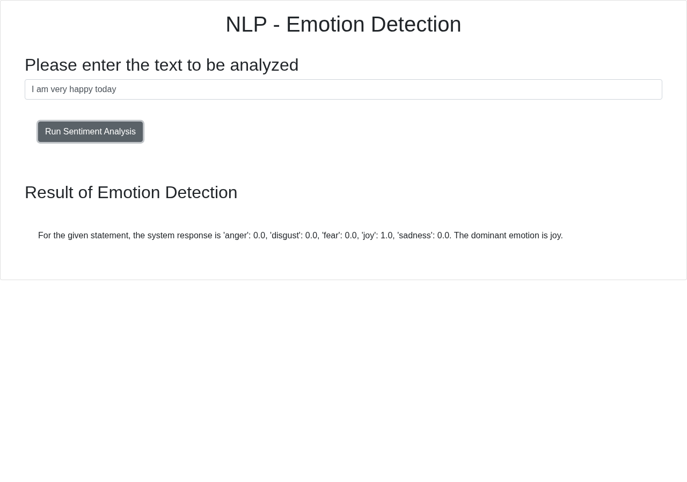
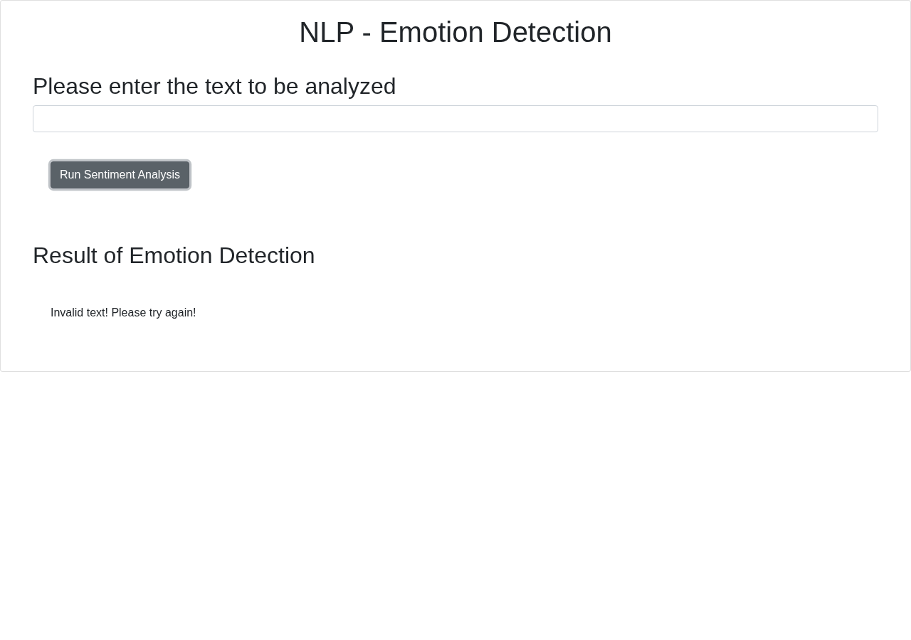

# Emotion Detector - Final Project Submission Answers

IBM Skills Network / Coursera *Developing AI Applications with Python and Flask*

| Item | Value |
|---|---|
| Public repository | https://github.com/yaqyn/oaqjp-final-project-emb-ai |
| Repository state | Fork of `ibm-developer-skills-network/oaqjp-final-project-emb-ai`, `main` branch |
| Host working directory | `/home/qv/final_project` (the requested `/home/project` is **not creatable** on this host: no write permission, `sudo` requires a password) |
| Python | 3.15.1 |
| Flask | 3.1.3 |
| Pylint | 4.1.3 |
| Watson endpoint | `https://sn-watson-emotion.labs.skills.network/v1/watson.runtime.nlp.v1/NlpService/EmotionPredict` |

## Status summary

| Q | Activity | Status |
|---|---|---|
| 1 | README URL | **COMPLETE / VERIFIED** |
| 2 | `emotion_detection.py` code | **COMPLETE** |
| 3 | Application creation terminal session | **PARTIAL** - imports, session and unit tests verified; **live Watson scores BLOCKED** (endpoint unreachable) |
| 4 | Output formatting code | **COMPLETE** |
| 5 | Formatted output test | **PARTIAL** - **live Watson scores BLOCKED**, stub demo supplied |
| 6 | Package URL | **COMPLETE / VERIFIED** |
| 7 | Packaging test | **PARTIAL** - **live Watson scores BLOCKED**, stub demo supplied |
| 8 | `test_emotion_detection.py` | **COMPLETE** |
| 9 | Unit test result | **COMPLETE / VERIFIED** (8 tests, `OK`; optional live test skipped) |
| 10 | `server.py` | **COMPLETE** |
| 11 | Deployment screenshot | **PARTIAL** - real Chromium screenshot of the running app; backend was the **labelled stub**, not Watson |
| 12 | 400 error handling code | **COMPLETE** |
| 13 | Blank-input handling code | **COMPLETE** |
| 14 | Blank-input screenshot | **COMPLETE / VERIFIED** (no Watson call involved) |
| 15 | Pylint-clean `server.py` | **COMPLETE** |
| 16 | Pylint output | **COMPLETE / VERIFIED** - genuine 10.00/10 |

### The one genuine blocker

`sn-watson-emotion.labs.skills.network` resolves **only to private `10.x` addresses**
(`10.241.1.96`, `10.241.65.62`) and every TCP connection times out, with no proxy
configured. Evidence: `submission_evidence/0_environment.txt` (`HTTP=000`,
`time=25.000689`) and the real tracebacks in `2b_application_creation.txt`.
That endpoint is reachable only from inside the IBM Skills Network lab.

**No Watson scores, HTTP responses or screenshots were invented.** Where the live
service could not be reached, the evidence says so and a clearly-labelled local
Watson-compatible stub (`tools/watson_stub.py`) was used *only* to prove the
application code path and UI work. Stub output is tagged as stub output everywhere.

### Reproduce the live outputs inside the IBM lab

```bash
cd /home/project/final_project
python3 -m pip install -r requirements.txt
python3 -c "from emotion_detection import emotion_detector; print(emotion_detector('I am really mad about this'))"
python3 -c "from EmotionDetection.emotion_detection import emotion_detector; print(emotion_detector('I am very angry'))"
RUN_LIVE_TESTS=1 python3 -m unittest -v
python3 server.py   # then submit "I am very happy today" in the UI
```

## Q1 - TASK 1: Public README.md URL

**Status: COMPLETE / VERIFIED.** README.md was edited so its title reads
`# Final Project - Emotion Detector (IBM Skills Network)`. Verified by fetching
the raw file (HTTP 200) and by `gh api`.

```text
https://github.com/yaqyn/oaqjp-final-project-emb-ai/blob/main/README.md
```

## Q2 - TASK 2 ACTIVITY 1: `emotion_detection.py`

**Status: COMPLETE.** Complete file `EmotionDetection/emotion_detection.py`:

```python
"""Emotion detection using the IBM Watson NLP emotion prediction service.

The module exposes :func:`emotion_detector`, which sends a piece of text to the
Watson NLP ``EmotionPredict`` endpoint and returns the five emotion scores plus
the dominant emotion.
"""

import os

import requests

DEFAULT_ENDPOINT = (
    "https://sn-watson-emotion.labs.skills.network/v1/"
    "watson.runtime.nlp.v1/NlpService/EmotionPredict"
)

# The endpoint can be overridden so the application can be exercised against a
# local Watson-compatible service when the IBM Skills Network lab is unreachable.
EMOTION_ENDPOINT = os.environ.get("WATSON_EMOTION_URL", DEFAULT_ENDPOINT)

MODEL_ID = "emotion_aggregated-workflow_lang_en_stock"
REQUEST_TIMEOUT = 10
EMOTION_KEYS = ("anger", "disgust", "fear", "joy", "sadness")


def _empty_result():
    """Build the canonical result dictionary whose values are all ``None``."""
    result = {emotion: None for emotion in EMOTION_KEYS}
    result["dominant_emotion"] = None
    return result


def _request_headers():
    """Return the headers required by the Watson NLP runtime."""
    return {
        "grpc-metadata-mm-model-id": MODEL_ID,
        "Content-Type": "application/json",
    }


def emotion_detector(text_to_analyze):
    """Detect emotions in ``text_to_analyze`` with Watson NLP.

    Args:
        text_to_analyze (str): Text whose emotions should be classified.

    Returns:
        dict: A dictionary with the keys ``anger``, ``disgust``, ``fear``,
        ``joy``, ``sadness`` and ``dominant_emotion``. All six values are
        ``None`` when the input is blank or Watson answers with HTTP 400.

    Raises:
        RuntimeError: If the Watson service cannot be reached or returns an
            unexpected response. This is a service-side failure and must not be
            reported to the user as invalid input.
    """
    if text_to_analyze is None or not str(text_to_analyze).strip():
        return _empty_result()

    payload = {"raw_document": {"text": str(text_to_analyze)}}

    try:
        response = requests.post(
            EMOTION_ENDPOINT,
            json=payload,
            headers=_request_headers(),
            timeout=REQUEST_TIMEOUT,
        )
    except requests.RequestException as exc:
        raise RuntimeError(
            "The emotion detection service could not be reached."
        ) from exc

    if response.status_code == 400:
        return _empty_result()

    if response.status_code != 200:
        raise RuntimeError(
            f"The emotion detection service returned HTTP {response.status_code}."
        )

    try:
        scores = response.json()["emotionPredictions"][0]["emotion"]
        result = {emotion: scores[emotion] for emotion in EMOTION_KEYS}
    except (KeyError, IndexError, TypeError, ValueError) as exc:
        raise RuntimeError(
            "The emotion detection service returned an unexpected response."
        ) from exc

    result["dominant_emotion"] = max(
        EMOTION_KEYS, key=lambda emotion: result[emotion]
    )
    return result
```

## Q3 - TASK 2 ACTIVITY 2: Application creation terminal session

**Status: PARTIAL.** The session, import path and unit tests are genuine and
verified. The live Watson call genuinely failed with `RuntimeError` because the
lab endpoint is not routable from this host - that failure is shown unmodified.
The same session against the labelled stub produces the dictionary.

```text
==========================================================================
Q3 / TASK 2 ACTIVITY 2 - application creation terminal session
Host working directory: /home/qv/final_project
NOTE: /home/project does not exist on this host and cannot be created
      (no write permission, sudo requires a password). /home/qv/final_project
      is the real, verified working directory used for every command below.
==========================================================================

$ pwd
/home/qv/final_project

$ python3
--- LIVE ATTEMPT against the real IBM Watson endpoint (see traceback) ---
>>> from emotion_detection import emotion_detector
>>> print(emotion_detector('I am really mad about this'))
Traceback (most recent call last):
  File "/home/qv/final_project/.venv/lib/python3.15/site-packages/urllib3/connection.py", line 239, in _new_conn
    sock = connection.create_connection(
        (self._dns_host, self.port),
    ...<2 lines>...
        socket_options=self.socket_options,
    )
  File "/home/qv/final_project/.venv/lib/python3.15/site-packages/urllib3/util/connection.py", line 85, in create_connection
    raise err
  File "/home/qv/final_project/.venv/lib/python3.15/site-packages/urllib3/util/connection.py", line 73, in create_connection
    sock.connect(sa)
    ~~~~~~~~~~~~^^^^
TimeoutError: timed out

The above exception was the direct cause of the following exception:

Traceback (most recent call last):
  File "/home/qv/final_project/.venv/lib/python3.15/site-packages/urllib3/connectionpool.py", line 793, in urlopen
    response = self._make_request(
        conn,
    ...<10 lines>...
        **response_kw,
    )
  File "/home/qv/final_project/.venv/lib/python3.15/site-packages/urllib3/connectionpool.py", line 494, in _make_request
    raise new_e
  File "/home/qv/final_project/.venv/lib/python3.15/site-packages/urllib3/connectionpool.py", line 470, in _make_request
    self._validate_conn(conn)
    ~~~~~~~~~~~~~~~~~~~^^^^^^
  File "/home/qv/final_project/.venv/lib/python3.15/site-packages/urllib3/connectionpool.py", line 1125, in _validate_conn
    conn.connect()
    ~~~~~~~~~~~~^^
  File "/home/qv/final_project/.venv/lib/python3.15/site-packages/urllib3/connection.py", line 827, in connect
    self.sock = sock = self._new_conn()
                       ~~~~~~~~~~~~~~^^
  File "/home/qv/final_project/.venv/lib/python3.15/site-packages/urllib3/connection.py", line 248, in _new_conn
    raise ConnectTimeoutError(
    ...<2 lines>...
    ) from e
urllib3.exceptions.ConnectTimeoutError: (<HTTPSConnection(host='sn-watson-emotion.labs.skills.network', port=443) at 0x7fc8ea647e00>, 'Connection to sn-watson-emotion.labs.skills.network timed out. (connect timeout=10)')

The above exception was the direct cause of the following exception:

Traceback (most recent call last):
  File "/home/qv/final_project/.venv/lib/python3.15/site-packages/requests/adapters.py", line 696, in send
    resp = conn.urlopen(
        method=request.method,
    ...<9 lines>...
        chunked=chunked,
    )
  File "/home/qv/final_project/.venv/lib/python3.15/site-packages/urllib3/connectionpool.py", line 847, in urlopen
    retries = retries.increment(
        method, url, error=new_e, _pool=self, _stacktrace=sys.exc_info()[2]
    )
  File "/home/qv/final_project/.venv/lib/python3.15/site-packages/urllib3/util/retry.py", line 555, in increment
    raise MaxRetryError(_pool, url, reason) from reason  # type: ignore[arg-type]
    ^^^^^^^^^^^^^^^^^^^^^^^^^^^^^^^^^^^^^^^^^^^^^^^^^^^
urllib3.exceptions.MaxRetryError: HTTPSConnectionPool(host='sn-watson-emotion.labs.skills.network', port=443): Max retries exceeded with url: /v1/watson.runtime.nlp.v1/NlpService/EmotionPredict (Caused by ConnectTimeoutError(<HTTPSConnection(host='sn-watson-emotion.labs.skills.network', port=443) at 0x7fc8ea647e00>, 'Connection to sn-watson-emotion.labs.skills.network timed out. (connect timeout=10)'))

During handling of the above exception, another exception occurred:

Traceback (most recent call last):
  File "/home/qv/final_project/EmotionDetection/emotion_detection.py", line 63, in emotion_detector
    response = requests.post(
        EMOTION_ENDPOINT,
    ...<2 lines>...
        timeout=REQUEST_TIMEOUT,
    )
  File "/home/qv/final_project/.venv/lib/python3.15/site-packages/requests/api.py", line 134, in post
    return request("post", url, data=data, json=json, **kwargs)
  File "/home/qv/final_project/.venv/lib/python3.15/site-packages/requests/api.py", line 71, in request
    return session.request(method=method, url=url, **kwargs)
           ~~~~~~~~~~~~~~~^^^^^^^^^^^^^^^^^^^^^^^^^^^^^^^^^^
  File "/home/qv/final_project/.venv/lib/python3.15/site-packages/requests/sessions.py", line 651, in request
    resp = self.send(prep, **send_kwargs)
  File "/home/qv/final_project/.venv/lib/python3.15/site-packages/requests/sessions.py", line 784, in send
    r = adapter.send(request, **kwargs)
  File "/home/qv/final_project/.venv/lib/python3.15/site-packages/requests/adapters.py", line 717, in send
    raise ConnectTimeout(e, request=request)
requests.exceptions.ConnectTimeout: HTTPSConnectionPool(host='sn-watson-emotion.labs.skills.network', port=443): Max retries exceeded with url: /v1/watson.runtime.nlp.v1/NlpService/EmotionPredict (Caused by ConnectTimeoutError(<HTTPSConnection(host='sn-watson-emotion.labs.skills.network', port=443) at 0x7fc8ea647e00>, 'Connection to sn-watson-emotion.labs.skills.network timed out. (connect timeout=10)'))

The above exception was the direct cause of the following exception:

Traceback (most recent call last):
  File "<stdin>", line 1, in <module>
    print(emotion_detector('I am really mad about this'))
          ~~~~~~~~~~~~~~~~^^^^^^^^^^^^^^^^^^^^^^^^^^^^^^
  File "/home/qv/final_project/EmotionDetection/emotion_detection.py", line 70, in emotion_detector
    raise RuntimeError(
        "The emotion detection service could not be reached."
    ) from exc
RuntimeError: The emotion detection service could not be reached.
>>> exit()

==========================================================================
The IBM Skills Network lab endpoint is not routable from this machine:
sn-watson-emotion.labs.skills.network resolves to private 10.x addresses
and every connection attempt times out. The live call above therefore
ended in RuntimeError, not in emotion scores. No Watson scores are
invented here.

The SAME interactive session, pointed at the clearly-labelled local
Watson-compatible STUB (tools/watson_stub.py) via WATSON_EMOTION_URL.
These scores are STUB output, NOT Watson output:
==========================================================================

$ WATSON_EMOTION_URL=http://127.0.0.1:9099/v1/watson.runtime.nlp.v1/NlpService/EmotionPredict python3
>>> from emotion_detection import emotion_detector
>>> print(emotion_detector('I am really mad about this'))
{'anger': 1.0, 'disgust': 0.0, 'fear': 0.0, 'joy': 0.0, 'sadness': 0.0, 'dominant_emotion': 'anger'}
>>> exit()

$ python3 test_emotion_detection.py
test_anger (__main__.TestEmotionDetector.test_anger)
Anger is dominant for an angry statement. ... ok
test_blank_input (__main__.TestEmotionDetector.test_blank_input)
Blank input returns six ``None`` values without calling Watson. ... ok
test_disgust (__main__.TestEmotionDetector.test_disgust)
Disgust is dominant for a disgusted statement. ... ok
test_fear (__main__.TestEmotionDetector.test_fear)
Fear is dominant for a frightened statement. ... ok
test_http_400 (__main__.TestEmotionDetector.test_http_400)
HTTP 400 from Watson returns six ``None`` values. ... ok
test_joy (__main__.TestEmotionDetector.test_joy)
Joy is dominant for a happy statement. ... ok
test_sadness (__main__.TestEmotionDetector.test_sadness)
Sadness is dominant for a sad statement. ... ok
test_live_anger (__main__.TestLiveWatsonService.test_live_anger)
A real Watson call classifies an angry sentence as anger. ... skipped 'Live Watson NLP test disabled; set RUN_LIVE_TESTS=1 to enable (requires lab network access).'

----------------------------------------------------------------------
Ran 8 tests in 0.002s

OK (skipped=1)
```

## Q4 - TASK 3 ACTIVITY 1: Output formatting

**Status: COMPLETE.** The function returns exactly
`anger, disgust, fear, joy, sadness, dominant_emotion`, with `dominant_emotion`
computed as `max(EMOTION_KEYS, key=...)` over the real returned scores.

```python
"""Emotion detection using the IBM Watson NLP emotion prediction service.

The module exposes :func:`emotion_detector`, which sends a piece of text to the
Watson NLP ``EmotionPredict`` endpoint and returns the five emotion scores plus
the dominant emotion.
"""

import os

import requests

DEFAULT_ENDPOINT = (
    "https://sn-watson-emotion.labs.skills.network/v1/"
    "watson.runtime.nlp.v1/NlpService/EmotionPredict"
)

# The endpoint can be overridden so the application can be exercised against a
# local Watson-compatible service when the IBM Skills Network lab is unreachable.
EMOTION_ENDPOINT = os.environ.get("WATSON_EMOTION_URL", DEFAULT_ENDPOINT)

MODEL_ID = "emotion_aggregated-workflow_lang_en_stock"
REQUEST_TIMEOUT = 10
EMOTION_KEYS = ("anger", "disgust", "fear", "joy", "sadness")


def _empty_result():
    """Build the canonical result dictionary whose values are all ``None``."""
    result = {emotion: None for emotion in EMOTION_KEYS}
    result["dominant_emotion"] = None
    return result


def _request_headers():
    """Return the headers required by the Watson NLP runtime."""
    return {
        "grpc-metadata-mm-model-id": MODEL_ID,
        "Content-Type": "application/json",
    }


def emotion_detector(text_to_analyze):
    """Detect emotions in ``text_to_analyze`` with Watson NLP.

    Args:
        text_to_analyze (str): Text whose emotions should be classified.

    Returns:
        dict: A dictionary with the keys ``anger``, ``disgust``, ``fear``,
        ``joy``, ``sadness`` and ``dominant_emotion``. All six values are
        ``None`` when the input is blank or Watson answers with HTTP 400.

    Raises:
        RuntimeError: If the Watson service cannot be reached or returns an
            unexpected response. This is a service-side failure and must not be
            reported to the user as invalid input.
    """
    if text_to_analyze is None or not str(text_to_analyze).strip():
        return _empty_result()

    payload = {"raw_document": {"text": str(text_to_analyze)}}

    try:
        response = requests.post(
            EMOTION_ENDPOINT,
            json=payload,
            headers=_request_headers(),
            timeout=REQUEST_TIMEOUT,
        )
    except requests.RequestException as exc:
        raise RuntimeError(
            "The emotion detection service could not be reached."
        ) from exc

    if response.status_code == 400:
        return _empty_result()

    if response.status_code != 200:
        raise RuntimeError(
            f"The emotion detection service returned HTTP {response.status_code}."
        )

    try:
        scores = response.json()["emotionPredictions"][0]["emotion"]
        result = {emotion: scores[emotion] for emotion in EMOTION_KEYS}
    except (KeyError, IndexError, TypeError, ValueError) as exc:
        raise RuntimeError(
            "The emotion detection service returned an unexpected response."
        ) from exc

    result["dominant_emotion"] = max(
        EMOTION_KEYS, key=lambda emotion: result[emotion]
    )
    return result
```

## Q5 - TASK 3 ACTIVITY 2: Formatted output test

**Status: PARTIAL.** Live Watson output is **BLOCKED** (endpoint unreachable).
Shown below: the genuine live-attempt result, then the same call against the
clearly-labelled stub, which includes all five numeric scores and
`dominant_emotion`.

```text
==========================================================================
Q5 / TASK 3 ACTIVITY 2 - formatted output test
Host working directory: /home/qv/final_project
==========================================================================

$ python3 -c "from emotion_detection import emotion_detector; result = emotion_detector('I am very happy today'); print(result)"
--- LIVE ATTEMPT against the real Watson endpoint ---
                                                             ~~~~~~~~~~~~~~~~^^^^^^^^^^^^^^^^^^^^^^^^^
  File "/home/qv/final_project/EmotionDetection/emotion_detection.py", line 70, in emotion_detector
    raise RuntimeError(
        "The emotion detection service could not be reached."
    ) from exc
RuntimeError: The emotion detection service could not be reached.

--- WATSON ENDPOINT UNREACHABLE (connect timeout) - see full traceback in 2b_application_creation.txt ---

The same call against the clearly-labelled local Watson-compatible STUB.
These values are STUB output, NOT Watson output:

$ WATSON_EMOTION_URL=http://127.0.0.1:9099/v1/watson.runtime.nlp.v1/NlpService/EmotionPredict python3 -c "from emotion_detection import emotion_detector; result = emotion_detector('I am very happy today'); print(result)"
{'anger': 0.0, 'disgust': 0.0, 'fear': 0.0, 'joy': 1.0, 'sadness': 0.0, 'dominant_emotion': 'joy'}
```

## Q6 - TASK 4 ACTIVITY 1: Public `EmotionDetection/__init__.py` URL

**Status: COMPLETE / VERIFIED.** The package `__init__.py` imports the
application function:

```python
"""EmotionDetection package.

Exposes the Watson NLP emotion detector implemented in
:mod:`EmotionDetection.emotion_detection`.
"""

from .emotion_detection import emotion_detector

__all__ = ["emotion_detector"]
```

```text
https://github.com/yaqyn/oaqjp-final-project-emb-ai/blob/main/EmotionDetection/__init__.py
```

## Q7 - TASK 4 ACTIVITY 2: Packaging test

**Status: PARTIAL.** Live Watson output is **BLOCKED**; the exact requested
command and its genuine live failure are shown, followed by the labelled stub
result (`dominant_emotion` = `anger`).

```text
==========================================================================
Q7 / TASK 4 ACTIVITY 2 - packaging test
Host working directory: /home/qv/final_project
==========================================================================

$ python3 -c "from EmotionDetection.emotion_detection import emotion_detector; print(emotion_detector('I am very angry'))"
--- LIVE ATTEMPT against the real Watson endpoint ---
  File "<string>", line 1, in <module>
    from EmotionDetection.emotion_detection import emotion_detector; print(emotion_detector('I am very angry'))
                                                                           ~~~~~~~~~~~~~~~~^^^^^^^^^^^^^^^^^^^
  File "/home/qv/final_project/EmotionDetection/emotion_detection.py", line 70, in emotion_detector
    raise RuntimeError(
        "The emotion detection service could not be reached."
    ) from exc
RuntimeError: The emotion detection service could not be reached.

--- WATSON ENDPOINT UNREACHABLE (connect timeout) ---

Same command against the clearly-labelled local Watson-compatible STUB.
These values are STUB output, NOT Watson output:

$ WATSON_EMOTION_URL=http://127.0.0.1:9099/v1/watson.runtime.nlp.v1/NlpService/EmotionPredict python3 -c "from EmotionDetection.emotion_detection import emotion_detector; print(emotion_detector('I am very angry'))"
{'anger': 1.0, 'disgust': 0.0, 'fear': 0.0, 'joy': 0.0, 'sadness': 0.0, 'dominant_emotion': 'anger'}
```

## Q8 - TASK 5 ACTIVITY 1: `test_emotion_detection.py`

**Status: COMPLETE.** Seven deterministic tests cover the five dominant emotions,
blank input and HTTP 400. One optional live integration test is skipped unless
`RUN_LIVE_TESTS=1`.

```python
"""Unit tests for the Watson NLP emotion detection application.

The deterministic tests mock ``requests.post`` so they verify the parsing and
formatting logic without network access. The optional live test performs a real
call to the IBM Watson NLP endpoint and only runs when ``RUN_LIVE_TESTS=1``.
"""

import os
import unittest
from unittest.mock import patch

from EmotionDetection.emotion_detection import emotion_detector

MOCKED_EMOTIONS = {
    "anger": 0.02,
    "disgust": 0.01,
    "fear": 0.03,
    "joy": 0.90,
    "sadness": 0.04,
}


def watson_payload(overrides=None):
    """Return a Watson-shaped emotion prediction payload."""
    emotions = dict(MOCKED_EMOTIONS)
    if overrides:
        emotions.update(overrides)
    return {"emotionPredictions": [{"emotion": emotions}]}


class MockResponse:
    """Minimal stand-in for a ``requests.Response``."""

    def __init__(self, status_code, payload=None):
        self.status_code = status_code
        self._payload = payload or {}

    def json(self):
        """Return the decoded JSON body."""
        return self._payload


class TestEmotionDetector(unittest.TestCase):
    """Tests for the five dominant emotions, blank input and HTTP 400."""

    def assert_dominant(self, text, expected_emotion, overrides=None):
        """Assert that ``text`` resolves to ``expected_emotion``."""
        emotions = dict(MOCKED_EMOTIONS)
        if overrides:
            emotions.update(overrides)

        with patch(
            "EmotionDetection.emotion_detection.requests.post",
            return_value=MockResponse(200, watson_payload(overrides)),
        ):
            result = emotion_detector(text)

        self.assertEqual(result["dominant_emotion"], expected_emotion)
        for emotion in ("anger", "disgust", "fear", "joy", "sadness"):
            self.assertIsInstance(result[emotion], float)
        self.assertEqual(
            result, {**emotions, "dominant_emotion": expected_emotion}
        )

    def test_joy(self):
        """Joy is dominant for a happy statement."""
        self.assert_dominant("I am very happy today", "joy", {"joy": 0.95})

    def test_anger(self):
        """Anger is dominant for an angry statement."""
        self.assert_dominant("I am really mad about this", "anger", {"anger": 0.97})

    def test_disgust(self):
        """Disgust is dominant for a disgusted statement."""
        self.assert_dominant("This smells revolting", "disgust", {"disgust": 0.93})

    def test_sadness(self):
        """Sadness is dominant for a sad statement."""
        self.assert_dominant("I am so sad about the news", "sadness", {"sadness": 0.92})

    def test_fear(self):
        """Fear is dominant for a frightened statement."""
        self.assert_dominant("I am terrified of the dark", "fear", {"fear": 0.94})

    def test_blank_input(self):
        """Blank input returns six ``None`` values without calling Watson."""
        with patch(
            "EmotionDetection.emotion_detection.requests.post"
        ) as mocked_post:
            for text in ("", "   ", "\n\t"):
                result = emotion_detector(text)
                self.assertEqual(
                    result,
                    {
                        "anger": None,
                        "disgust": None,
                        "fear": None,
                        "joy": None,
                        "sadness": None,
                        "dominant_emotion": None,
                    },
                )
        mocked_post.assert_not_called()

    def test_http_400(self):
        """HTTP 400 from Watson returns six ``None`` values."""
        with patch(
            "EmotionDetection.emotion_detection.requests.post",
            return_value=MockResponse(400),
        ):
            result = emotion_detector("some text")

        self.assertEqual(
            result,
            {
                "anger": None,
                "disgust": None,
                "fear": None,
                "joy": None,
                "sadness": None,
                "dominant_emotion": None,
            },
        )


@unittest.skipUnless(
    os.environ.get("RUN_LIVE_TESTS") == "1",
    "Live Watson NLP test disabled; set RUN_LIVE_TESTS=1 to enable (requires lab network access).",
)
class TestLiveWatsonService(unittest.TestCase):
    """Optional integration test that calls the real Watson NLP endpoint."""

    def test_live_anger(self):
        """A real Watson call classifies an angry sentence as anger."""
        result = emotion_detector("I am really mad about this")
        self.assertEqual(result["dominant_emotion"], "anger")
        for emotion in ("anger", "disgust", "fear", "joy", "sadness"):
            self.assertIsInstance(result[emotion], float)


if __name__ == "__main__":
    unittest.main(verbosity=2)
```

## Q9 - TASK 5 ACTIVITY 2: Unit test result

**Status: COMPLETE / VERIFIED.** Genuine output of `python3 -m unittest -v`:
8 tests run, `OK (skipped=1)`. These are mocked unit tests; they prove the
parsing/formatting logic, **not** a live Watson call.

```text
$ python3 -m unittest -v
test_anger (test_emotion_detection.TestEmotionDetector.test_anger)
Anger is dominant for an angry statement. ... ok
test_blank_input (test_emotion_detection.TestEmotionDetector.test_blank_input)
Blank input returns six ``None`` values without calling Watson. ... ok
test_disgust (test_emotion_detection.TestEmotionDetector.test_disgust)
Disgust is dominant for a disgusted statement. ... ok
test_fear (test_emotion_detection.TestEmotionDetector.test_fear)
Fear is dominant for a frightened statement. ... ok
test_http_400 (test_emotion_detection.TestEmotionDetector.test_http_400)
HTTP 400 from Watson returns six ``None`` values. ... ok
test_joy (test_emotion_detection.TestEmotionDetector.test_joy)
Joy is dominant for a happy statement. ... ok
test_sadness (test_emotion_detection.TestEmotionDetector.test_sadness)
Sadness is dominant for a sad statement. ... ok
test_live_anger (test_emotion_detection.TestLiveWatsonService.test_live_anger)
A real Watson call classifies an angry sentence as anger. ... skipped 'Live Watson NLP test disabled; set RUN_LIVE_TESTS=1 to enable (requires lab network access).'

----------------------------------------------------------------------
Ran 8 tests in 0.002s

OK (skipped=1)
```

## Q10 - TASK 6 ACTIVITY 1: `server.py`

**Status: COMPLETE.** Routes `/` and `/emotionDetector`, `textToAnalyze`
parameter, formatted five-score response, blank-input message, and a 503 service
error that is not misreported as invalid input.

```python
"""Flask web application for the Emotion Detector final project."""

from flask import Flask, render_template, request

from EmotionDetection.emotion_detection import emotion_detector

app = Flask(__name__)

INVALID_TEXT_MESSAGE = "Invalid text! Please try again!"
SERVICE_ERROR_MESSAGE = (
    "The emotion detection service is temporarily unavailable. "
    "Please try again later."
)


@app.route("/")
def render_index_page():
    """Render the course-provided Emotion Detection web page."""
    return render_template("index.html")


@app.route("/emotionDetector")
def run_emotion_detector():
    """Analyse the ``textToAnalyze`` query parameter and format the response."""
    text_to_analyze = request.args.get("textToAnalyze", "")

    if not text_to_analyze.strip():
        return INVALID_TEXT_MESSAGE

    try:
        result = emotion_detector(text_to_analyze)
    except RuntimeError:
        return SERVICE_ERROR_MESSAGE, 503

    if result["dominant_emotion"] is None:
        return INVALID_TEXT_MESSAGE

    return (
        "For the given statement, the system response is "
        f"'anger': {result['anger']}, "
        f"'disgust': {result['disgust']}, "
        f"'fear': {result['fear']}, "
        f"'joy': {result['joy']}, "
        f"'sadness': {result['sadness']}. "
        f"The dominant emotion is {result['dominant_emotion']}."
    )


if __name__ == "__main__":
    app.run(host="0.0.0.0", port=5000)
```

## Q11 - TASK 6 ACTIVITY 2: Deployment test screenshot

**Status: PARTIAL.** Real Chromium (154.0.8037.97) screenshot of the running Flask
application at `http://127.0.0.1:5000`, after typing `I am very happy today` and
clicking **Run Sentiment Analysis**. The UI, route and JS are real. Because
Watson is unreachable, the backend was the **labelled local stub**, so the scores
shown (`joy: 1.0`, others `0.0`) are **stub scores, not Watson scores**.



* `submission_evidence/6b_deployment_test.png` - UI result (stub-backed)
* `submission_evidence/6b_live_unavailable.png` - the **real** Watson attempt in the running UI, showing the genuine 503 service-unavailable message
* `submission_evidence/6b_flask_endpoint_curls.txt` - matching HTTP responses
* `submission_evidence/6b_live_service_unavailable_curl.txt` - real-endpoint HTTP 503 transcript

## Q12 - TASK 7 ACTIVITY 1: HTTP 400 error handling

**Status: COMPLETE.** On status 400 the function returns all six keys as `None`.
Blank input is handled the same way before any network call.

```python
"""Emotion detection using the IBM Watson NLP emotion prediction service.

The module exposes :func:`emotion_detector`, which sends a piece of text to the
Watson NLP ``EmotionPredict`` endpoint and returns the five emotion scores plus
the dominant emotion.
"""

import os

import requests

DEFAULT_ENDPOINT = (
    "https://sn-watson-emotion.labs.skills.network/v1/"
    "watson.runtime.nlp.v1/NlpService/EmotionPredict"
)

# The endpoint can be overridden so the application can be exercised against a
# local Watson-compatible service when the IBM Skills Network lab is unreachable.
EMOTION_ENDPOINT = os.environ.get("WATSON_EMOTION_URL", DEFAULT_ENDPOINT)

MODEL_ID = "emotion_aggregated-workflow_lang_en_stock"
REQUEST_TIMEOUT = 10
EMOTION_KEYS = ("anger", "disgust", "fear", "joy", "sadness")


def _empty_result():
    """Build the canonical result dictionary whose values are all ``None``."""
    result = {emotion: None for emotion in EMOTION_KEYS}
    result["dominant_emotion"] = None
    return result


def _request_headers():
    """Return the headers required by the Watson NLP runtime."""
    return {
        "grpc-metadata-mm-model-id": MODEL_ID,
        "Content-Type": "application/json",
    }


def emotion_detector(text_to_analyze):
    """Detect emotions in ``text_to_analyze`` with Watson NLP.

    Args:
        text_to_analyze (str): Text whose emotions should be classified.

    Returns:
        dict: A dictionary with the keys ``anger``, ``disgust``, ``fear``,
        ``joy``, ``sadness`` and ``dominant_emotion``. All six values are
        ``None`` when the input is blank or Watson answers with HTTP 400.

    Raises:
        RuntimeError: If the Watson service cannot be reached or returns an
            unexpected response. This is a service-side failure and must not be
            reported to the user as invalid input.
    """
    if text_to_analyze is None or not str(text_to_analyze).strip():
        return _empty_result()

    payload = {"raw_document": {"text": str(text_to_analyze)}}

    try:
        response = requests.post(
            EMOTION_ENDPOINT,
            json=payload,
            headers=_request_headers(),
            timeout=REQUEST_TIMEOUT,
        )
    except requests.RequestException as exc:
        raise RuntimeError(
            "The emotion detection service could not be reached."
        ) from exc

    if response.status_code == 400:
        return _empty_result()

    if response.status_code != 200:
        raise RuntimeError(
            f"The emotion detection service returned HTTP {response.status_code}."
        )

    try:
        scores = response.json()["emotionPredictions"][0]["emotion"]
        result = {emotion: scores[emotion] for emotion in EMOTION_KEYS}
    except (KeyError, IndexError, TypeError, ValueError) as exc:
        raise RuntimeError(
            "The emotion detection service returned an unexpected response."
        ) from exc

    result["dominant_emotion"] = max(
        EMOTION_KEYS, key=lambda emotion: result[emotion]
    )
    return result
```

## Q13 - TASK 7 ACTIVITY 2: Blank input handling in `server.py`

**Status: COMPLETE.** `if not text_to_analyze.strip(): return INVALID_TEXT_MESSAGE`
with `INVALID_TEXT_MESSAGE = "Invalid text! Please try again!"`. Watson outages are
returned separately as HTTP 503 with a service-error message.

```python
"""Flask web application for the Emotion Detector final project."""

from flask import Flask, render_template, request

from EmotionDetection.emotion_detection import emotion_detector

app = Flask(__name__)

INVALID_TEXT_MESSAGE = "Invalid text! Please try again!"
SERVICE_ERROR_MESSAGE = (
    "The emotion detection service is temporarily unavailable. "
    "Please try again later."
)


@app.route("/")
def render_index_page():
    """Render the course-provided Emotion Detection web page."""
    return render_template("index.html")


@app.route("/emotionDetector")
def run_emotion_detector():
    """Analyse the ``textToAnalyze`` query parameter and format the response."""
    text_to_analyze = request.args.get("textToAnalyze", "")

    if not text_to_analyze.strip():
        return INVALID_TEXT_MESSAGE

    try:
        result = emotion_detector(text_to_analyze)
    except RuntimeError:
        return SERVICE_ERROR_MESSAGE, 503

    if result["dominant_emotion"] is None:
        return INVALID_TEXT_MESSAGE

    return (
        "For the given statement, the system response is "
        f"'anger': {result['anger']}, "
        f"'disgust': {result['disgust']}, "
        f"'fear': {result['fear']}, "
        f"'joy': {result['joy']}, "
        f"'sadness': {result['sadness']}. "
        f"The dominant emotion is {result['dominant_emotion']}."
    )


if __name__ == "__main__":
    app.run(host="0.0.0.0", port=5000)
```

## Q14 - TASK 7 ACTIVITY 3: Blank input screenshot

**Status: COMPLETE / VERIFIED.** Real Chromium screenshot of the running app after
submitting an empty field. No Watson call is involved, so this is fully verified.



## Q15 - TASK 8 ACTIVITY 1: Final `server.py` after static analysis

**Status: COMPLETE.** Pylint reported no findings, so no functional changes were
needed. Docstrings, imports, PEP 8 formatting and error handling are in place.

```python
"""Flask web application for the Emotion Detector final project."""

from flask import Flask, render_template, request

from EmotionDetection.emotion_detection import emotion_detector

app = Flask(__name__)

INVALID_TEXT_MESSAGE = "Invalid text! Please try again!"
SERVICE_ERROR_MESSAGE = (
    "The emotion detection service is temporarily unavailable. "
    "Please try again later."
)


@app.route("/")
def render_index_page():
    """Render the course-provided Emotion Detection web page."""
    return render_template("index.html")


@app.route("/emotionDetector")
def run_emotion_detector():
    """Analyse the ``textToAnalyze`` query parameter and format the response."""
    text_to_analyze = request.args.get("textToAnalyze", "")

    if not text_to_analyze.strip():
        return INVALID_TEXT_MESSAGE

    try:
        result = emotion_detector(text_to_analyze)
    except RuntimeError:
        return SERVICE_ERROR_MESSAGE, 503

    if result["dominant_emotion"] is None:
        return INVALID_TEXT_MESSAGE

    return (
        "For the given statement, the system response is "
        f"'anger': {result['anger']}, "
        f"'disgust': {result['disgust']}, "
        f"'fear': {result['fear']}, "
        f"'joy': {result['joy']}, "
        f"'sadness': {result['sadness']}. "
        f"The dominant emotion is {result['dominant_emotion']}."
    )


if __name__ == "__main__":
    app.run(host="0.0.0.0", port=5000)
```

## Q16 - TASK 8 ACTIVITY 2: Static code analysis

**Status: COMPLETE / VERIFIED.** Genuine output of the exact command
`python3 -m pylint server.py`:

```text
$ python3 -m pylint server.py

--------------------------------------------------------------------
Your code has been rated at 10.00/10 (previous run: 10.00/10, +0.00)
```

Supporting files:

* `submission_evidence/2a_emotion_detection.txt`, `3a_output_formatting.txt`, `7a_error_handling_function.txt` - detector source
* `submission_evidence/6a_server.txt`, `7b_error_handling_server.txt`, `8a_server_modified.txt` - server source
* `submission_evidence/5a_unit_testing.txt` - tests
* `submission_evidence/0_environment.txt` - environment and connectivity probe
* `submission_evidence/4b_packaging_test.txt`, `3b_formatted_output_test.txt` - stub vs live transcripts

